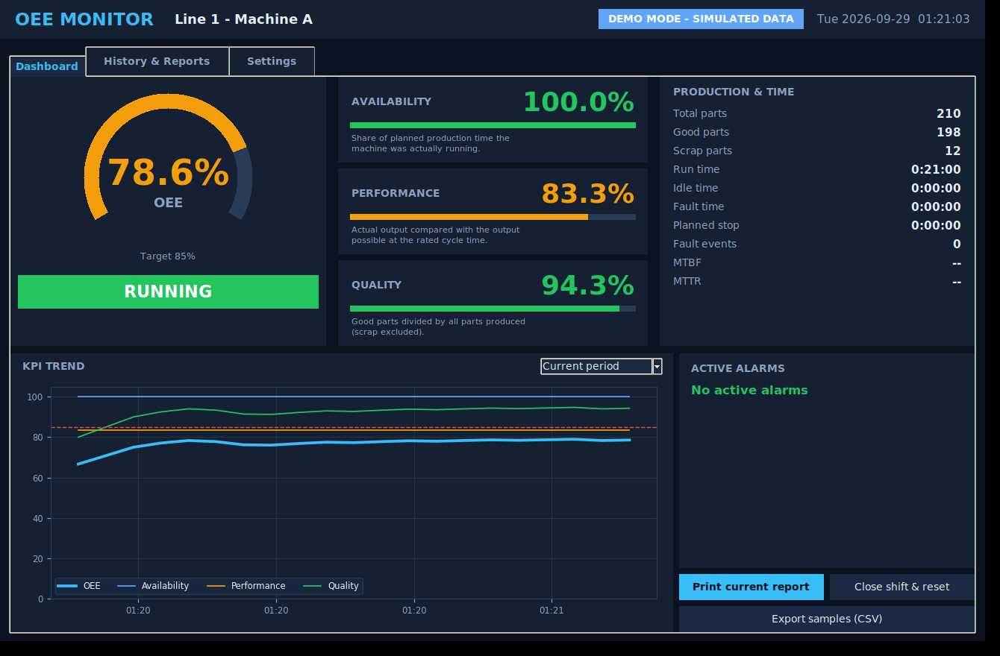

# SLC 500 OEE Monitor

**Open-source OEE monitoring, alarm history and printable reports for legacy Allen-Bradley SLC 5/04 and SLC 5/05 PLCs - no controller replacement required.**



## What you get

| Component | Location |
|---|---|
| Ladder subroutine (36 rungs, identical for 5/04 and 5/05) | `plc/` |
| Python desktop application: live gauge, KPI cards, trends, alarm panel, history, PDF reports, CSV export, demo simulator | `src/oee_monitor/` |
| Step-by-step implementation guide (PDF, English) | `docs/Implementation_Guide.pdf` |
| Engineering article (PDF and web page) | `docs/Article.pdf`, `site/index.html` |
| Sample shift report | `docs/Sample_Shift_Report.pdf` |
| Unit tests | `tests/` |

## Quick start (2 minutes, no PLC needed)

```bash
pip install -r requirements.txt      # Linux: also sudo apt install python3-tk
python oee_monitor.py                # starts in Demo mode with simulated data
```

To connect to a real machine follow `docs/Implementation_Guide.pdf` (Sections 6-9): add the `OEE_MON` subroutine, map your I/O, set the PLC IP
address in **Settings** and clear **Demo mode**.

## KPI definitions

```
Planned production time (PPT) = Run + Idle + Fault            (planned stops excluded)
Availability = Run / PPT
Performance  = (Ideal cycle time x Total count) / Run          (capped at 100 %)
Quality      = Good / Total
OEE          = Availability x Performance x Quality
MTBF = Run / Fault events      MTTR = Fault time / Fault events
```

Structure consistent with ISO 22400-2:2014 and TPM (Nakajima); supports evidence for IATF 16949:2016 clauses 8.5.1.5 and 9.1.1.1 and ISO 9001:2015 clause 9.1.
Verify exact wording requirements with your certification body.

## What changed from the original prototype

| Original | Problem | This version |
|---|---|---|
| Scrap rung subtracted 10 from the total-parts counter | Total production count was corrupted | Separate reject pulse and counter; totals are never decremented |
| Times stored in seconds in one signed 16-bit word | Overflow after about 9 hours | Seconds + minutes registers; PC reads values as unsigned |
| `GEQ` in diagram but `GRT` in ASCII code; timer base mismatch | Inconsistent behaviour | Single generated source (`tools/build_plc.py`) |
| Fault, idle and run bits could overlap | Time double-counted | Priority logic: planned > fault > run > idle |
| Alarm word never written | Alarm display always empty | Alarm inputs mapped to N10:0 bits; any bit = FAULT |
| No planned-stop state | Breaks reduced OEE unfairly | Planned stop excluded from planned production time |
| No fault counter | No MTBF / MTTR | Fault-event counter |
| Console output only | No history or reports | GUI, SQLite history, PDF reports, CSV export |
| No stopped-PLC detection | Stale data looked normal | Heartbeat register |

## Validation status

The KPI mathematics, simulator, database and report generator are covered by automated tests (`python -m unittest discover -s tests`) and the GUI
was smoke-tested. **Field validation on physical SLC hardware must be performed by the implementer** using the commissioning protocol in Section 9 of the guide.
Field reports are welcome (see `CONTRIBUTING.md`).

## Rebuild the documents

```bash
pip install markdown
python tools/build_plc.py && python tools/build_docs.py
```

## Safety and disclaimer

Alarm inputs are for monitoring only and never replace hardwired safety functions. Software provided "as is" under the MIT licence; validate before production
use. Allen-Bradley, SLC and RSLogix are trademarks of Rockwell Automation, Inc.; this project is independent and not affiliated with Rockwell Automation.

## Citation

See `CITATION.cff`.
